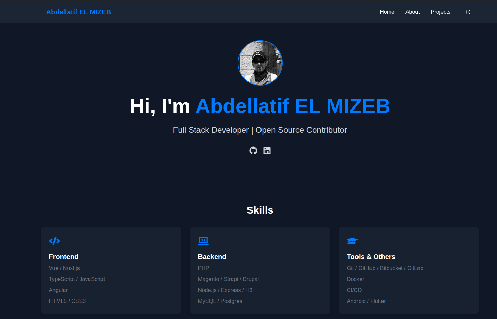

# Personal Website
My personal website built with React, GitHub Actions and GitHub Pages.

## Development

Use Node.js 24 (see `.nvmrc`), then install and validate the project:

```sh
nvm use
npm ci
npm run lint
npm test -- --run
npm run build
```

The static build fetches Google Fonts and content from Firebase, so it requires network access.

ESLint stays on version 9 because the React, import, and accessibility plugins in Next.js's ESLint configuration do not support ESLint 10 yet. TypeScript stays on version 6 because Next.js and typescript-eslint use its JavaScript API, which [TypeScript 7.0 does not provide](https://devblogs.microsoft.com/typescript/announcing-typescript-7-0/).

## Publishing articles

Articles are stored in the Firebase `articles` collection. The listing reads Firebase in the browser, while article detail pages and the sitemap are generated during `next build`. After adding an article or changing its content or slugs in Firebase, rerun **Deploy Next.js site to Pages** from the repository's Actions tab and wait for deployment to finish. Otherwise, the listing can link to an article that has not been exported yet.

The deployment uses `next.config.ts` directly and passes the GitHub Pages base path through `NEXT_PUBLIC_BASE_PATH`. With `trailingSlash: true`, each exported article has an `index.html` inside its route directory. Avoid enabling automatic Next.js configuration in `actions/configure-pages`, because it can generate a separate `next.config.js` and override these settings.

If Cloudflare is enabled, bypass caching for HTML pages and Next.js route payloads, and purge any old page or 404 responses after deployment when necessary. Keep versioned files under `/_next/static/` cacheable.

## 🔎 Preview
[See result](https://aelmizeb.github.io/personal-website/)



## 🚀 Features

- Built with modern JavaScript, using tools and frameworks like [framer-motion](https://github.com/motiondivision/motion), and based on work from [Devfolio](https://github.com/mdalmamunit427/devfolio-nextjs-portfolio-website/tree/main).
- Automated workflows via [GitHub Actions](https://github.com/features/actions).
- And more!
